  <!--  -->

  

  
  

 

## Hi, I'm Namrata 👋

I'm a full-stack developer from India. I like building the whole thing, from the database and the API to the last hover effect on the button.

I work mostly with **React, Node and MongoDB**, and I've also built on **Shopify**, so I'm comfortable with Liquid themes too.

What I enjoy most is **motion**. A page that just loads is fine, but a page that moves with you is the one people remember. That's the part of the job I never get tired of.

If you have a project that needs someone who cares about how it *feels* as well as how it works, let's talk.

 

## Tech Stack

  

 

**Full-Stack**

**Animation**

**Also worked on**

**Tools**

 

## GitHub Stats

  
  

  

 

  

 

## Let's Connect

  
  
  

 

🏅 GSSOC'24 Badges

 

<!-- Paste your GSSOC badge images here -->

